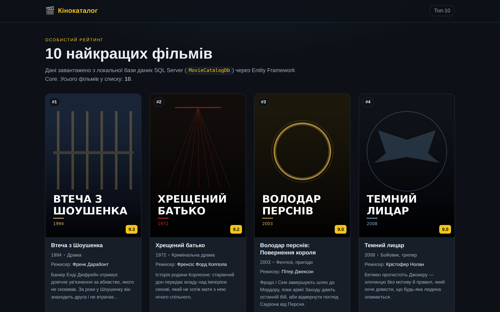
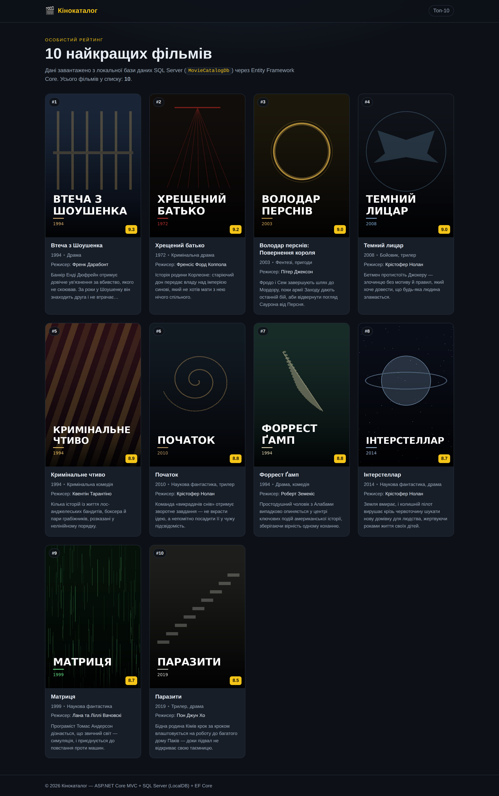
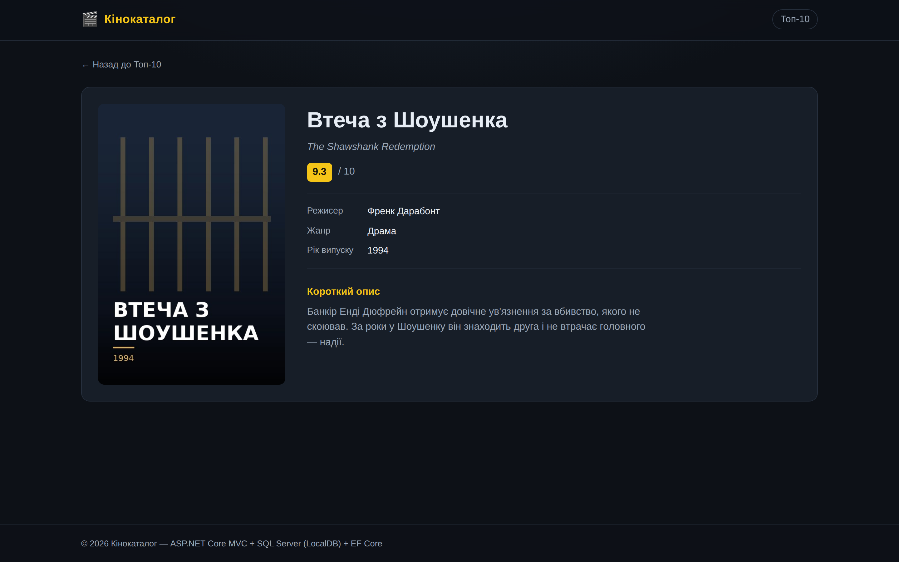
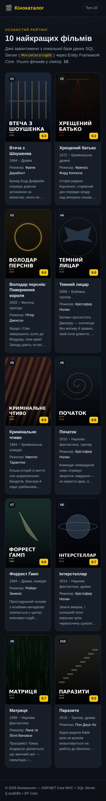

# 🎬 Кінокаталог — ASP.NET Core MVC + SQL Server

Навчальний веб-додаток: на стартовій сторінці виводиться **10 найкращих фільмів**
у вигляді адаптивної сітки з постерами. Усі дані зберігаються в **локальній базі
даних SQL Server (LocalDB)** і зчитуються через **Entity Framework Core**.

**Стек:** ASP.NET Core MVC (.NET 10) · Entity Framework Core 10 · SQL Server LocalDB · Razor · CSS Grid

---

## Скріншоти

### Головна сторінка — сітка Топ-10



### Уся сітка з 10 фільмів



### Сторінка фільму



### Мобільна версія



---

## Структура даних — таблиця `dbo.Movies`

| Поле | Тип у БД | Опис |
| --- | --- | --- |
| `Id` | `int` (PK, identity) | Первинний ключ |
| `Title` | `nvarchar(200)` | **Назва фільму** |
| `OriginalTitle` | `nvarchar(200)`, null | Оригінальна назва |
| `Director` | `nvarchar(120)` | **Режисер** |
| `Genre` | `nvarchar(80)` | **Жанр** |
| `ReleaseYear` | `int` | **Рік випуску** |
| `PosterPath` | `nvarchar(260)` | **Постер** — відносний шлях до файлу у `wwwroot/images/posters` |
| `Description` | `nvarchar(1000)` | **Короткий опис** |
| `Rating` | `decimal(3,1)` | Оцінка 0–10, за нею сортується Топ-10 |

Постери зберігаються файлами у `wwwroot`, а в базі — лише шлях до них
(щоб не роздувати БД бінарними даними).

---

## Структура репозиторію

```
WebApplication23333/
├── WebApplication23333.slnx
├── README.md
├── .gitignore
├── screenshots/                    # скріншоти інтерфейсу
├── tools/
│   ├── generate_posters.py         # генерація постерів (Python + Pillow)
│   └── make_preview.py             # службовий скрипт прев'ю для скріншотів
└── WebApplication23333/
    ├── Program.cs                  # AddDbContext + UseSqlServer + EnsureCreated()
    ├── appsettings.json            # рядок підключення DefaultConnection
    ├── Controllers/
    │   ├── MoviesController.cs     # повний CRUD: Index / Details / Create / Edit / Delete
    │   └── HomeController.cs       # обробка помилок і сторінка 404
    ├── Data/AppDbContext.cs        # DbContext + конфігурація + seed 10 фільмів
    ├── Models/Movie.cs
    ├── Views/
    │   ├── Movies/Index.cshtml     # сітка карток + кнопки дій
    │   ├── Movies/Details.cshtml   # сторінка фільму
    │   ├── Movies/Create.cshtml    # форма додавання
    │   ├── Movies/Edit.cshtml      # форма редагування
    │   ├── Movies/Delete.cshtml    # підтвердження видалення
    │   └── Shared/
    │       ├── _Layout.cshtml
    │       ├── _Message.cshtml     # повідомлення про успішну дію
    │       ├── NotFound.cshtml     # власна сторінка 404
    │       └── Error.cshtml
    └── wwwroot/
        ├── css/site.css            # темна тема, адаптивна сітка, форми
        ├── images/posters/*.jpg    # 10 стартових постерів
        └── images/uploads/         # постери, завантажені через веб-інтерфейс
```

---

## Як запустити

### Вимоги

- .NET SDK 10.0 (проєкт націлений на net10.0)
- SQL Server LocalDB (входить до Visual Studio 2022, компонент
  «ASP.NET and web development») або SQL Server Express

### Visual Studio 2022

1. Відкрити `WebApplication23333.slnx`
2. Натиснути **F5**

### Командний рядок

```bash
cd WebApplication23333
dotnet restore
dotnet run
```

Відкрити <https://localhost:7080> (або адресу з консолі).

База даних **створюється автоматично** при першому запуску разом із
початковими даними (`Database.EnsureCreated()` у `Program.cs`).

> ⚠️ `EnsureCreated()` нічого не робить, якщо база `MovieCatalogDb` уже існує.
> Якщо ви змінили модель `Movie` — видаліть базу (SQL Server Object Explorer →
> ПКМ на `MovieCatalogDb` → Delete, або `sqllocaldb`) і запустіть додаток знову,
> або перейдіть на міграції (див. розділ нижче).

### Рядок підключення

`appsettings.json`:

```json
"Server=(localdb)\\MSSQLLocalDB;Database=MovieCatalogDb;Trusted_Connection=True;MultipleActiveResultSets=true;TrustServerCertificate=True"
```

Для SQL Server Express:

```json
"Server=.\\SQLEXPRESS;Database=MovieCatalogDb;Trusted_Connection=True;TrustServerCertificate=True"
```

---

## Як це працює

**`Program.cs`** — реєстрація контексту та автостворення БД:

```csharp
var connectionString = builder.Configuration.GetConnectionString("DefaultConnection");
builder.Services.AddDbContext<AppDbContext>(o => o.UseSqlServer(connectionString));

using (var scope = app.Services.CreateScope())
{
    var context = scope.ServiceProvider.GetRequiredService<AppDbContext>();
    context.Database.EnsureCreated();
}
```

**`HomeController.Index`** — читання Топ-10 з бази:

```csharp
var topMovies = await _context.Movies
    .AsNoTracking()
    .OrderByDescending(m => m.Rating)
    .ThenBy(m => m.Title)
    .Take(10)
    .ToListAsync();

return View(topMovies);
```

**`AppDbContext`** — конфігурація моделі та seed:

```csharp
modelBuilder.Entity<Movie>(entity =>
{
    entity.ToTable("Movies");
    entity.HasKey(m => m.Id);
    entity.Property(m => m.Rating).HasColumnType("decimal(3,1)");
    entity.HasIndex(m => m.Rating);
});

modelBuilder.Entity<Movie>().HasData(SeedMovies);   // 10 фільмів
```

---

## CRUD-операції

Усі операції над фільмами зібрані в одному контролері — `MoviesController`.

| Дія | Маршрут | Метод | Опис |
| --- | --- | --- | --- |
| **Read** | `/Movies` | GET | Сітка всіх фільмів, відсортована за оцінкою |
| **Details** | `/Movies/Details/{id}` | GET | Повна картка: рік, режисер, жанр, опис, постер |
| **Create** | `/Movies/Create` | GET / POST | Форма додавання + завантаження постера |
| **Update** | `/Movies/Edit/{id}` | GET / POST | Редагування полів і заміна постера |
| **Delete** | `/Movies/Delete/{id}` | GET / POST | Сторінка підтвердження, потім видалення |

### Валідація

- **На стороні моделі** — атрибути `Required`, `StringLength`, `Range` у `Models/Movie.cs`,
  результат перевіряється через `ModelState.IsValid`.
- **На стороні клієнта** — `jquery.validate` + `jquery.validate.unobtrusive`
  (підключені через `_ValidationScriptsPartial` у секції `Scripts`), тому помилки
  показуються ще до відправлення форми.
- Форми захищені `[ValidateAntiForgeryToken]`.

### Завантаження постера

Форми `Create` і `Edit` відправляються як `multipart/form-data`, файл приймається
параметром `IFormFile? posterFile`:

- дозволені формати — `.jpg`, `.jpeg`, `.png`, `.webp`, `.gif`;
- максимальний розмір — 5 МБ;
- файл зберігається у `wwwroot/images/uploads` під іменем-`Guid`, у базу пише́ться лише шлях;
- якщо файл не обрано під час створення — підставляється заглушка `poster-placeholder.svg`;
- при редагуванні старий завантажений постер видаляється, при видаленні фільму — теж.

### Сторінка 404

У `Program.cs` підключено `app.UseStatusCodePagesWithReExecute("/Home/StatusCodeHandler/{0}")`.
`HomeController.StatusCodeHandler` для коду 404 повертає власне подання
`Views/Shared/NotFound.cshtml`, для інших кодів — `Error.cshtml`.
Неіснуючий `id` у `Details` / `Edit` / `Delete` теж призводить до цієї сторінки.

---

## Міграції EF Core (опційно)

Якщо потрібні саме міграції замість `EnsureCreated()`:

```bash
dotnet tool install --global dotnet-ef
cd WebApplication23333
dotnet ef migrations add InitialCreate
dotnet ef database update
```

І в `Program.cs` замінити `context.Database.EnsureCreated()` на `context.Database.Migrate()`.

---

## Список фільмів у базі

| # | Фільм | Режисер | Жанр | Рік | Оцінка |
| --- | --- | --- | --- | --- | --- |
| 1 | Втеча з Шоушенка | Френк Дарабонт | Драма | 1994 | 9.3 |
| 2 | Хрещений батько | Френсіс Форд Коппола | Кримінальна драма | 1972 | 9.2 |
| 3 | Володар перснів: Повернення короля | Пітер Джексон | Фентезі, пригоди | 2003 | 9.0 |
| 4 | Темний лицар | Крістофер Нолан | Бойовик, трилер | 2008 | 9.0 |
| 5 | Кримінальне чтиво | Квентін Тарантіно | Кримінальна комедія | 1994 | 8.9 |
| 6 | Форрест Ґамп | Роберт Земекіс | Драма, комедія | 1994 | 8.8 |
| 7 | Початок | Крістофер Нолан | Наукова фантастика, трилер | 2010 | 8.8 |
| 8 | Інтерстеллар | Крістофер Нолан | Наукова фантастика, драма | 2014 | 8.7 |
| 9 | Матриця | Лана та Ліллі Вачовскі | Наукова фантастика | 1999 | 8.7 |
| 10 | Паразити | Пон Джун Хо | Трилер, драма | 2019 | 8.5 |

---

## Про постери

Постери — **власна згенерована графіка** (градієнт + геометричний мотив + назва),
створена скриптом `tools/generate_posters.py` на Python + Pillow. Чужих зображень
у репозиторії немає. Перегенерувати:

```bash
python tools/generate_posters.py
```
